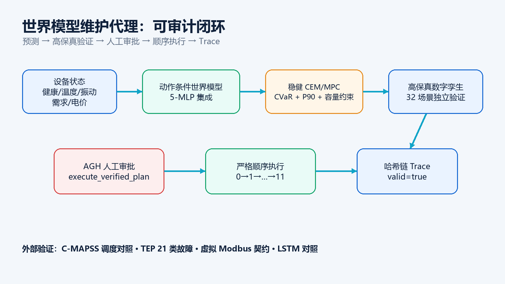

# World-Model-Driven Industrial Equipment Predictive Maintenance & Scheduling Agent

<div align="center">

**English** · [简体中文](README.zh-CN.md)


</div>

> **2026 Jiangsu Province University AI + Science & Engineering Innovation Hackathon** · Undergraduate Group · Team ID **U068** · Team **YiZhi AeroAgent (翼智AeroAgent)**
>
> 📦 **GitHub:** <https://github.com/Conch-help/world-model-maintenance-agent> · 🎬 **Demo video:** <https://www.bilibili.com/video/BV1Jspj66Eed>

A closed-loop **Agent** that turns industrial equipment maintenance from a passive "remaining-useful-life prediction" into an **auditable decision chain**: an **action-conditioned world model** proposes maintenance/production plans, an independent **high-fidelity digital twin** verifies them across scenarios, **AGH (Agnes Harness)** requires **human approval** before any state-changing action, and a **SHA-256 hash-chain Trace** makes every step tamper-evident.

---

## 1. Project Overview

### Background

Industrial maintenance is not simply "predict a remaining useful life (RUL)":

- Maintain **too early** → unnecessary downtime and maintenance cost;
- Maintain **too late** → failures, higher energy use and unmet production demand;
- Let a model **directly actuate equipment** → safety and accountability risk.

This project decomposes the problem into one auditable closed loop:

```text
Equipment state
  → Action-conditioned world model
  → Robust CEM/MPC planning
  → High-fidelity digital-twin verification (32 scenarios)
  → AGH human approval
  → Strict sequential execution (0 → 1 → … → 11)
  → SHA-256 hash-chain Trace
```

### Core Features

1. **Action-Conditioned Ensemble World Model** — a 5-MLP ensemble predicts the *next-step* state, production and single-step profit from current health/temperature/vibration, demand, electricity price, time and a *joint maintenance action*.
2. **Robust CEM/MPC Planner** — plans multi-step actions while jointly optimizing profit **CVaR₁₀**, failure probability, failure P90, unmet-demand P90 and capacity constraints.
3. **High-Fidelity Digital Twin Verification** — clones the *current* physical state but replaces the *future* randomness stream, validating every plan over **32 independent scenarios** to avoid oracle leakage.
4. **Safety Shield** — independent rules that force maintenance or derating when health is low or temperature is high; the verifier and the real executor use the *same* shield.
5. **AGH MCP Toolchain** — 8 MCP tools wired into Agnes Harness for read → plan → verify → request approval → execute → calibrate → export trace.
6. **Hash-Chain Trace** — every tool call, approval, execution and calibration event is appended to a SHA-256 hash chain; any tampering flips `valid=false`.
7. **External Public-Data Validation** — NASA C-MAPSS (RUL + maintenance-scheduling baseline) and Tennessee Eastman Process (21 fault classes), with negative results retained.

### Innovation Highlights

- Upgrades "predictive maintenance" to an **action-conditioned world model + auditable decision loop**, not just a scalar RUL estimate.
- Brings **CVaR and failure quantiles** plus a **safety shield** into maintenance planning.
- Requires **two hard gates** for any plant-changing action: *high-fidelity verification* **and** *explicit human approval*, then records it in a **hash-chain trace**.
- Validates on **public real degradation/process data** and keeps failure/negative samples instead of hiding them.

### Headline Result

A real `agnes-3.0-flash` session, after **one plan-level human approval**, strictly executed `0 → 1 → … → 11`:

- **12/12** real work orders, `plan_status.completed = true`
- **Actual profit 14,529.53** · verified profit 11,181.30
- **Actual failures 0** · safety-shield adjustments 9
- Online calibration `profit_scale = 1.2994`, `failure_bias = 0`
- Trace `valid = true`, **41 events**, final hash `ad6187f0…a3f82a`

---

## 2. Demo Video

**Main demo (Bilibili):** <https://www.bilibili.com/video/BV1Jspj66Eed>

- Duration **3 min 28 s**, 1920×1080, 30 fps
- Voiceover: Microsoft Edge TTS `zh-CN-YunyangNeural` (male)
- Subtitles: `deliverables/voiceover/最终视频字幕.srt`
- Covers: problem definition → world-model planning → high-fidelity verification → AGH approval card → real execution evidence → external validation → boundaries

> The full 4-minute storyboard is in [`docs/DEMO_SCRIPT.md`](docs/DEMO_SCRIPT.md); per-page narration is in [`deliverables/演示视频-逐页讲解稿.md`](deliverables/演示视频-逐页讲解稿.md).

---

## 3. Architecture



### Core Modules

| Module | File | Responsibility |
|---|---|---|
| Digital twin | `src/wm_maint/plant.py` | Independent stochastic plant: degradation, thermodynamics, vibration, random failures, maintenance, demand/electricity price, capacity |
| World model | `src/wm_maint/world_model.py` | 5-MLP ensemble action-conditioned one-step predictor |
| Planner | `src/wm_maint/planner.py` | CEM/MPC multi-step search + 32-scenario verification + robust scoring |
| Tools / gates / trace | `src/wm_maint/tools.py` | MCP tools, two approval gates, strict ordering, hash-chain trace |
| MCP server | `src/wm_maint/mcp_server.py` | stdio MCP entry point |
| Adapters | `src/wm_maint/adapters/` | `plc_contract.py` (PLC/DCS command contract), `daypsci.py` (DAYPSCI schema) |
| AGH wiring | `agnes/` | `mcp_config.json`, `SKILL.md`, `system_prompt.md`, `AGH_RUNBOOK.md` |

### Implementation: the closed loop

```text
plant_read_state
  → world_model_plan(horizon=12)
  → highfidelity_verify(plan_id)          # 32 scenarios, tail-risk report
  → request_maintenance_action(approved=false)   # → approval_required
  → (human approves once in AGH)
  → execute_verified_plan(approved=true)  # strict 0 → 1 → … → 11
  → plan_status / calibration_status
  → trace_export                          # SHA-256 hash chain, valid=true
```

Details: [`docs/ARCHITECTURE.md`](docs/ARCHITECTURE.md) · [`docs/MODEL_CARD.md`](docs/MODEL_CARD.md) · [`docs/RESULTS.md`](docs/RESULTS.md) · [`docs/TAIL_RISK.md`](docs/TAIL_RISK.md).

---

## 4. Integration Standards

### 4.1 MCP Interface

The agent is exposed as a **Model Context Protocol (MCP)** server over **stdio**, registered in Agnes Harness.

- Config: [`agnes/mcp_config.json`](agnes/mcp_config.json)
- Skill: [`agnes/SKILL.md`](agnes/SKILL.md)
- System prompt: [`agnes/system_prompt.md`](agnes/system_prompt.md)
- Runbook: [`agnes/AGH_RUNBOOK.md`](agnes/AGH_RUNBOOK.md)

### 4.2 The 8 MCP Tools

| # | Tool | Purpose |
|---|---|---|
| 1 | `plant_read_state` | Read current plant state |
| 2 | `world_model_plan` | Generate a candidate action plan |
| 3 | `highfidelity_verify` | Validate plan over 32 scenarios |
| 4 | `request_maintenance_action` | Request a state-changing action (gated) |
| 5 | `execute_verified_plan` | Execute an approved, verified plan sequentially |
| 6 | `plan_status` | Inspect executed/remaining steps |
| 7 | `calibration_status` | Read online profit/failure calibration |
| 8 | `trace_export` | Export the hash-chain trace |

### 4.3 Approval & Safety Gates

Any plant-changing action passes **two hard gates**:

1. The plan must have passed `highfidelity_verify` with `all_pass = true`;
2. The call must carry an **explicit human approval** (`approved = true`).

Execution is **strictly ordered** `0 → 1 → … → 11`; out-of-sequence requests return `blocked_out_of_sequence`.

### 4.4 PLC / DCS Integration Contract (future extension)

This submission does **not** connect to field PLC/DCS. The contract (`src/wm_maint/adapters/plc_contract.py`) requires **all** preconditions before a real command:

1. `watchdog_ok = true`
2. `emergency_stop = false`
3. `maintenance_permission = true`
4. a real `approval_id`
5. a complete `trace_id`
6. action mode within the allowed set
7. execution budget ≤ 4 hours

Interface mapping: device health/temperature/vibration/demand/price → **read-only registers**; maintenance requests → **write coils** or controlled register writes; every write carries `approval_id` + `trace_id`; the controller keeps its own local E-stop and interlocks. Failure of any precondition must **reject**, never silently downgrade to auto-execution.

### 4.5 Safety Shield Rules

Independent of the world model, evaluated before every action:

- health `< 0.42` → **force maintenance**
- health `< 0.68` → derate full load
- temperature above ambient `+25 °C` → derate full load
- already down / under maintenance → skip

The verifier and the real executor share these rules, so verification and execution never diverge.

### 4.6 Trace

SHA-256 hash chain over `(seq, UTC time, event type, payload, prev_hash, hash)`. Editing any historical event flips `trace_export.valid` to `false`.

### 4.7 Third-Party Data & Licenses

| Source | License / Attribution | Use |
|---|---|---|
| NASA C-MAPSS FD001 | Public benchmark; cite Saxena et al., PHM 2008 | RUL + maintenance-scheduling baseline |
| Tennessee Eastman Process (Mode 1) | MIT (`Blound04/tennessee-eastman-dataset`); Downs & Vogel (1993), Bathelt et al. (2015) | 21-fault detection/classification |
| DAYPSCI v1 | Adapter + fail-closed tests only; no fabricated results | Future authorized-data extension |
| PLC-BEAD | Not process time-series; not used for scheduling | — |

Full details: [`docs/DATA_LICENSES.md`](docs/DATA_LICENSES.md) · [`docs/EXTERNAL_VALIDATION.md`](docs/EXTERNAL_VALIDATION.md) · [`docs/TEP_VALIDATION.md`](docs/TEP_VALIDATION.md).

---

## Results Highlights

**Strategy comparison** (10 unseen seeds, 168 h each) — full table in [`docs/RESULTS.md`](docs/RESULTS.md):

| Strategy | Avg profit | Avg failures |
|---|---:|---:|
| Full production, no maintenance | −81,081.4 | 23.1 |
| Fixed-interval maintenance | −29.1 | 20.1 |
| Threshold maintenance (baseline) | 92,814.5 | 7.0 |
| World-model planning | **119,558.9 (+28.8%)** | 8.4 |
| World model + high-fidelity verify | **110,274.0 (+18.8%)** | 9.4 |

**World model one-step prediction:** health RMSE 0.0191 · full-state RMSE 0.0456 · profit MAE 319.9 · ensemble coverage 94.56% (1σ) / 97.07% (2σ).

**Safety shield** (10 seeds): avg failures 8.80 → **6.00**, downtime 66.4 h → **44.4 h**, profit CVaR₁₀ 1,444.14 → **4,253.52**.

**External validation:** C-MAPSS FD001 RUL MAE 11.95 / RMSE 16.22 / R² 0.836 · TEP 21-fault detection 86.67% with 1.34% false-alarm rate (weak faults — e.g. fault 21 at 0% — are conservatively routed to human review).

---

## Quick Start

### Environment

- **Python ≥ 3.10**
- Dependencies: `numpy`, `scipy` (see [`pyproject.toml`](pyproject.toml) for optional extras `plot`, `dev`, `cmapss`, `tep`, `sequence`, `plc`)

```powershell
python -m venv .venv
.\.venv\Scripts\Activate.ps1
pip install -e .
```

### Run

```powershell
$env:PYTHONPATH = "src"

# Train the world model
python -m wm_maint.cli train

# Benchmark on the 10 held-out seeds
python -m wm_maint.cli evaluate --seeds 101,202,303,404,505,606,707,808,909,1010

# MCP contract smoke test + closed-loop evidence
python scripts\mcp_smoke.py
python scripts\run_closed_loop_demo.py

# Unit tests
python -m unittest discover -s tests -t . -v
```

**Connect to AGH:** register the server in `agnes/mcp_config.json`, trust & enable it in Agnes Harness, then follow [`agnes/AGH_RUNBOOK.md`](agnes/AGH_RUNBOOK.md). Real-session evidence is in [`docs/AGH_EVIDENCE.md`](docs/AGH_EVIDENCE.md) and the sanitized [`artifacts/agh_real_summary.json`](artifacts/agh_real_summary.json).

---

## Repository Structure

```text
src/wm_maint/          world model, planner, plant, MCP tools, adapters
scripts/               training/eval/validation scripts
configs/               default plant / model / planner config
agnes/                 AGH MCP config, skill, system prompt, runbook
docs/                  architecture, results, model card, licenses, evidence
artifacts/             models, benchmarks, trace & closed-loop evidence (sanitized)
deliverables/          PPT, project brief, images, voiceover, release copy
tests/                 unit tests
```

---

## Attribution & Licenses

- **Code:** MIT — see [`LICENSE`](LICENSE).
- **Citation:** [`CITATION.cff`](CITATION.cff).
- **Third-party data & tools:** [`docs/DATA_LICENSES.md`](docs/DATA_LICENSES.md).
- No API keys, tokens, cookies, student identity data, absolute user paths, raw AGH sessions, or unauthorized industrial data are included (see [`SECURITY.md`](SECURITY.md) and [`PUBLIC_RELEASE_NOTES.md`](PUBLIC_RELEASE_NOTES.md)).

## Honest Boundaries

The "high-fidelity" environment is a **self-built stochastic digital twin**, **not** a field PLC/DCS or real production line. Virtual Modbus validates the protocol and command contract only; TEP is a public process simulation; C-MAPSS is a public degradation benchmark; DAYPSCI validation waits for authorized files. This repository never presents simulation results as field deployment.

## License

[MIT](LICENSE) © 2026 Team YiZhi AeroAgent (U068).
